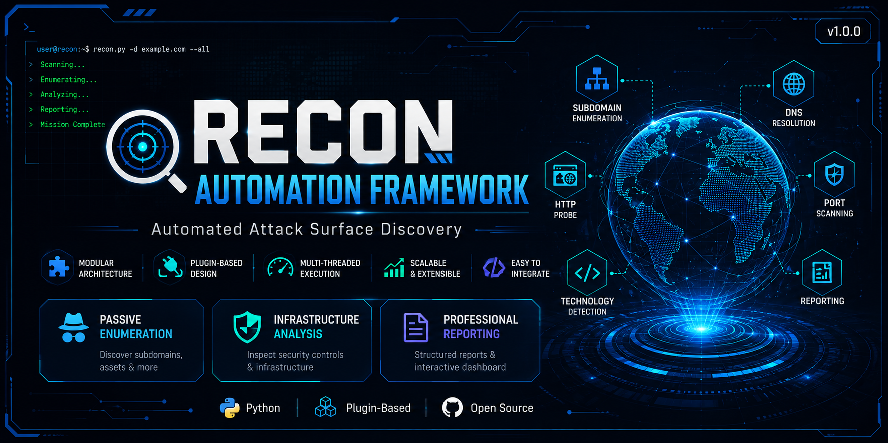
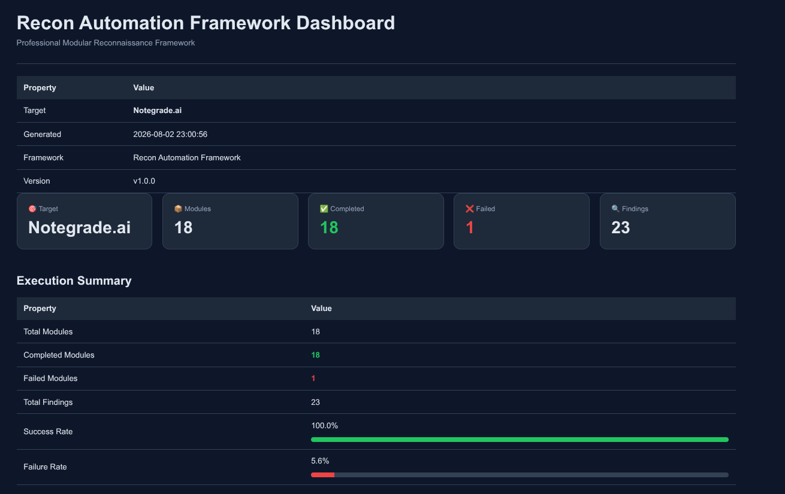
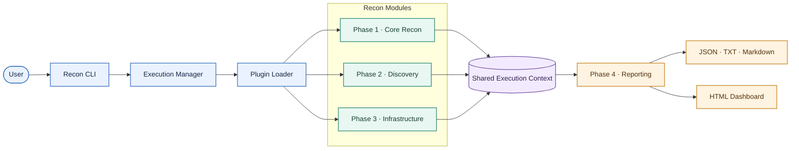
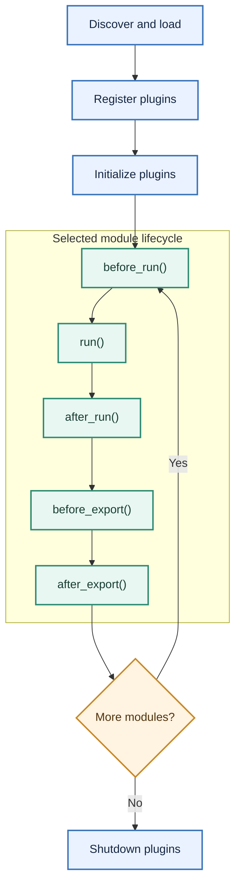
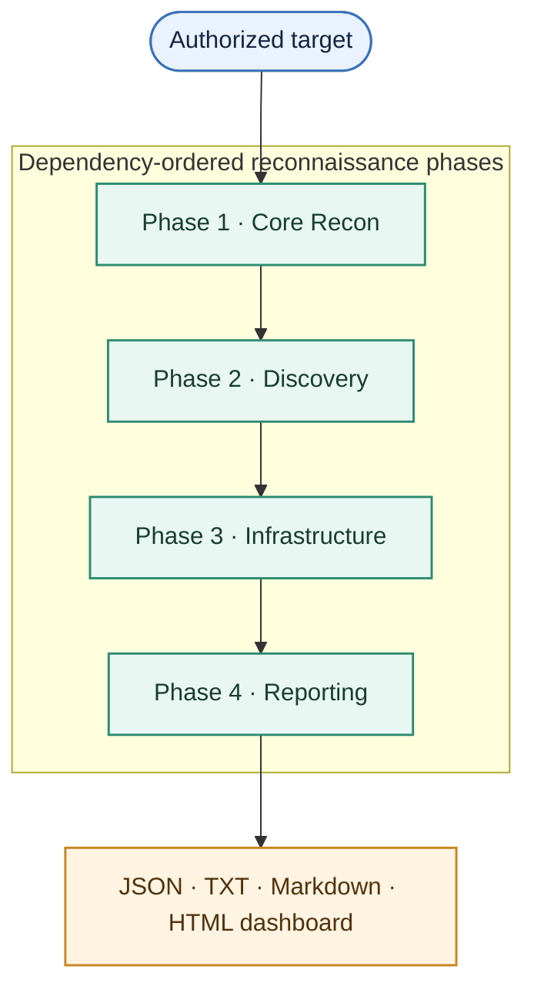
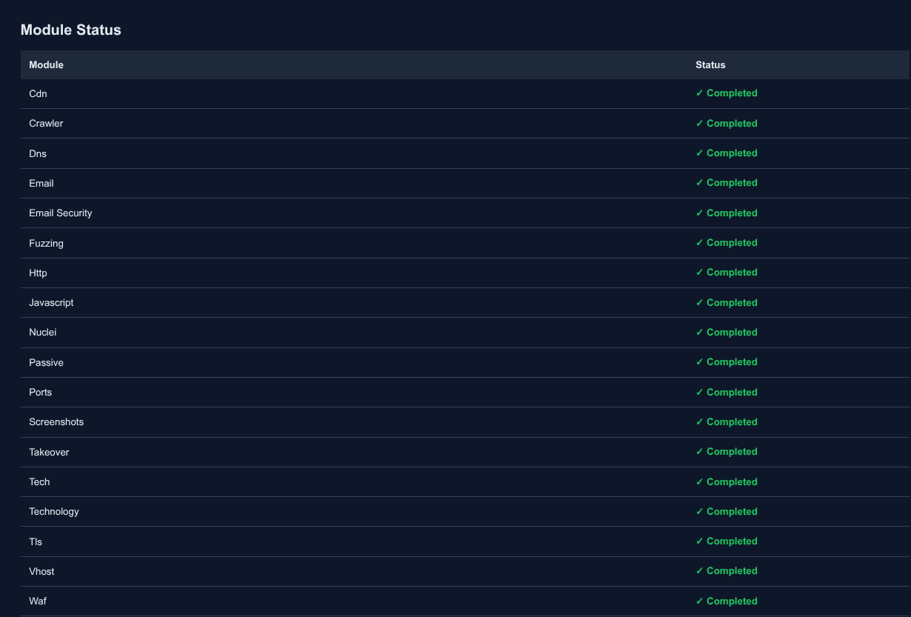
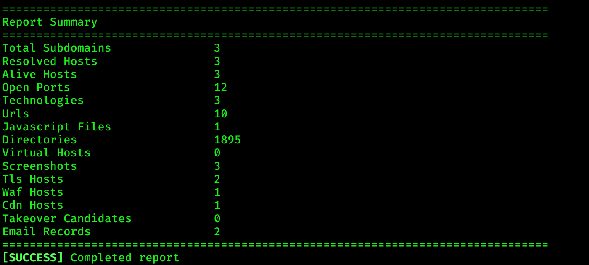
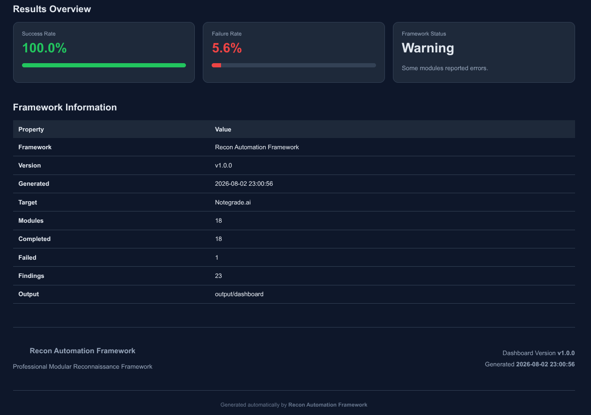

<h1 align="center">
🔍 Recon Automation Framework
</h1>

<p align="center">
<strong>A modular toolkit for authorized attack surface reconnaissance</strong>
</p>

<p align="center">
Automated Reconnaissance • Plugin Architecture • Multi-threading • Professional Reporting
</p>

<p align="center">
  <a href="#️-installation">Install</a> ·
  <a href="#-usage">Usage</a> ·
  <a href="#-supported-modules">Modules</a>
</p>

<p align="center">
  
</p>

<p align="center">
  
  
  
  
  
</p>

## 📖 Overview

An extensible reconnaissance toolkit for authorized security assessments. Run modules individually or as a dependency-aware workflow, then review results in structured reports and an interactive dashboard.

## 📑 Table of Contents

- [Overview](#-overview)
- [Features](#-features)
- Framework design
  - [Architecture](#️-framework-architecture)
  - [Plugin architecture](#-plugin-architecture)
  - [Recon pipeline](#-recon-pipeline)
- [Supported modules](#-supported-modules)
  - [Phase 1 — Core Recon](#phase-1--core-recon)
  - [Phase 2 — Discovery](#-phase-2--discovery)
  - [Phase 3 — Infrastructure](#-phase-3--infrastructure)
  - [Phase 4 — Reporting](#-phase-4--reporting)
  - [Framework services](#-framework-services)
- [Project structure](#-project-structure)
- Setup and usage
  - [Installation](#️-installation)
  - [Configuration](#️-configuration)
  - [CLI usage](#-usage)
  - [Output](#-output)
- Project information
  - [Roadmap](#️-roadmap)
  - [FAQ](#-frequently-asked-questions)
  - [Contributing](#-contributing)
  - [License](#-license)
  - [Acknowledgements](#-acknowledgements)
  - [Author](#-author)

## ✨ Features

Recon Automation Framework provides a complete reconnaissance workflow through a modular, extensible, and plugin-based architecture.

### ⚙️ Framework Capabilities

- Modular, plugin-based architecture
- 18 specialized reconnaissance modules
- Automated, phase-based workflow
- Multi-threaded execution
- Interactive HTML dashboard
- Reports in JSON, TXT, and Markdown formats, plus an HTML dashboard

<div align="left">
  
</div>

## 🏗️ Framework Architecture

Recon Automation Framework organizes reconnaissance tasks into independent modules coordinated through a shared execution context.



The execution manager loads the selected plugins, resolves their dependencies, and shares module results through a common context.

## 🔌 Plugin Architecture

Each capability is an independent plugin. The manager discovers and initializes plugins, runs the selected modules, and shuts them down when the scan ends.

### Plugin Lifecycle

For each selected module, the manager runs the hooks in order and passes results to the export stage.



## 🔄 Recon Pipeline

The framework orders selected plugins by dependency, adds prerequisites automatically, and generates reports after reconnaissance completes.

### Pipeline Overview



### Phase Breakdown

| Phase | Modules |
|--------|---------|
| **Phase 1 — Core Recon** | Passive Enumeration, DNS Resolution, HTTP Probe, Port Scanner, Technology Detection, Screenshot Capture |
| **Phase 2 — Discovery** | URL Discovery, JavaScript Analysis, Directory Fuzzing, Virtual Host Discovery |
| **Phase 3 — Infrastructure** | Nuclei, TLS Analysis, WAF Detection, CDN Detection, Takeover Detection, Email Security |
| **Phase 4 — Reporting** | Report Generator, HTML Dashboard |
| **Framework Services** | CLI, plugin loading, dependency resolution, shared context, performance tracking |

## 📁 Project Structure

The repository separates the command-line interface, shared framework services, and reconnaissance plugins. Scan results are written to `output/` when the framework runs.

```text
Recon-Automation-Framework/
├── cli/
│   ├── config.py
│   ├── parser.py
│   ├── pipeline.py
│   └── validation.py
├── config/
│   └── config.py
├── core/
│   ├── performance/          # Profiling, benchmarks, and reports
│   ├── plugins/              # Plugin discovery, loading, and registry
│   ├── analysis.py
│   ├── context.py
│   ├── executor.py
│   ├── http.py
│   ├── logger.py
│   ├── resolvers.py
│   └── utils.py
├── modules/
│   ├── cdn/
│   ├── crawler/
│   ├── dashboard/
│   ├── dns/
│   ├── email/
│   ├── fuzzing/
│   ├── http/
│   ├── javascript/
│   ├── nuclei/
│   ├── passive/
│   ├── ports/
│   ├── report/
│   ├── screenshots/
│   ├── takeover/
│   ├── tech/
│   ├── tls/
│   ├── vhost/
│   └── waf/
├── wordlists/
│   ├── directories/
│   └── vhosts/
├── images/                  # README screenshots and banner
├── output/                  # Generated scan data and reports
├── recon.py                 # Application entry point
├── requirements.txt         # Runtime dependencies
├── pyproject.toml           # Project and tooling configuration
├── README.md
├── CONTRIBUTING.md
├── SECURITY.md
├── CODE_OF_CONDUCT.md
└── LICENSE
```

| Component | Responsibility |
|---|---|
| `cli/` | Argument parsing, input validation, and scan orchestration |
| `core/` | Shared execution context, logging, HTTP utilities, plugin lifecycle, and performance tools |
| `config/` | Framework settings and configuration defaults |
| `modules/` | Pluggable reconnaissance, discovery, infrastructure, and reporting features |
| `wordlists/` | Directory and virtual-host wordlists used during discovery |
| `output/` | Scan artifacts and generated reports; populated at runtime |
| `images/` | Screenshots and visual assets used by the README |

Each plugin lives in its own `modules/<name>/` package. The files vary by module, while plugin entry points and shared interfaces are managed by `core/plugins/`.

## 📦 Supported Modules

The framework includes dedicated modules for reconnaissance, discovery, infrastructure analysis, reporting, and framework management.

| Phase | Modules | Included Components |
|--------|:------:|---------------------|
| **Phase 1 — Core Recon** | **6** | Passive, DNS, HTTP, Ports, Technology, Screenshots |
| **Phase 2 — Discovery** | **4** | Crawler, JavaScript, Fuzzing, VHost |
| **Phase 3 — Infrastructure** | **6** | Nuclei, TLS, WAF, CDN, Takeover, Email |
| **Phase 4 — Reporting** | **2** | Report, Dashboard |
| **Framework Services** | — | CLI, plugin loader, dependency resolver, shared context, performance tracking |

### Phase 1 — Core Recon

#### 🌐 Passive Enumeration

Passive Enumeration discovers subdomains and publicly available assets without directly interacting with the target infrastructure. It gathers information from multiple external intelligence sources while minimizing noise through normalization and deduplication.

##### Features

- Multi-source subdomain enumeration
- Public intelligence collection
- Result normalization and deduplication
- Automated export of discovered assets

##### Example

```bash
python recon.py example.com --passive
```

#### 🌍 DNS Resolution

DNS Resolution validates discovered subdomains by resolving DNS records and collecting information required by subsequent reconnaissance modules.

##### Features

- Multi-threaded DNS resolution
- Record validation
- Fast lookup processing
- Structured result generation

##### Example

```bash
python recon.py example.com --dns
```

#### 🌐 HTTP Probe

HTTP Probe verifies which hosts are reachable over HTTP or HTTPS and collects response metadata for further analysis.

##### Features

- HTTP/HTTPS validation
- Status code detection
- Response metadata collection
- Redirect handling
- Title extraction

##### Example

```bash
python recon.py example.com --http
```

#### 📸 Screenshot Capture

Screenshot Capture generates visual previews of live web applications to simplify manual analysis and asset identification.

##### Features

- Asynchronous screenshot capture
- Full-page rendering
- Automatic page title extraction
- Organized screenshot storage

##### Example

```bash
python recon.py example.com --screenshots
```

#### 🔓 Port Scanner

Port Scanner identifies open network ports and running services across discovered hosts using concurrent scanning techniques.

##### Features

- TCP port scanning
- Multi-threaded execution
- Service identification
- Configurable port ranges
- Structured scan results

##### Example

```bash
python recon.py example.com --ports
```

#### 🛠️ Technology Detection

Technology Detection fingerprints web technologies used by target applications, providing insight into the underlying software stack.

##### Features

- CMS detection
- Web server identification
- Programming language detection
- JavaScript framework detection
- Library and technology fingerprinting

##### Example

```bash
python recon.py example.com --tech
```

### 🔍 Phase 2 — Discovery

The Discovery phase expands the identified attack surface by analyzing web applications, extracting hidden resources, and discovering additional entry points for security assessment.

#### 🔗 URL Discovery

URL Discovery crawls target web applications to collect publicly accessible URLs and identify content that may be valuable for further analysis.

##### Features

- Recursive web crawling
- URL normalization
- Internal link discovery
- JavaScript file collection
- Structured URL export

##### Example

```bash
python recon.py example.com --crawler
```

#### 📜 JavaScript Analysis

JavaScript Analysis downloads and analyzes JavaScript files to identify endpoints, hidden resources, secrets, and other information useful during reconnaissance.

##### Features

- JavaScript download and parsing
- Endpoint extraction
- URL discovery
- Source map detection
- Secret detection
- Interesting file and directory identification
- Structured report generation

##### Example

```bash
python recon.py example.com --javascript
```

#### 📂 Directory Fuzzing

Directory Fuzzing discovers hidden files and directories by testing common paths against the target web server.

##### Features

- Multi-threaded fuzzing
- Configurable wordlists
- Recursive directory discovery
- Response filtering
- Status code analysis

##### Example

```bash
python recon.py example.com --fuzzing
```

#### 🌍 Virtual Host Discovery

Virtual Host Discovery identifies additional virtual hosts configured on the target web server that may not be publicly referenced.

##### Features

- Virtual host enumeration
- Host header fuzzing
- Response comparison
- Hidden application discovery
- Multi-threaded execution

##### Example

```bash
python recon.py example.com --vhost
```

### 🌐 Phase 3 — Infrastructure

The Infrastructure phase analyzes security controls and infrastructure components to provide a better understanding of the target environment.

#### 🧪 Nuclei Vulnerability Scan

Nuclei runs template-based checks against discovered HTTP services and consolidates matching findings. The Nuclei command-line tool must be installed separately.

##### Example

```bash
python recon.py example.com --nuclei
```

#### 🔐 TLS Analysis

TLS Analysis inspects SSL/TLS configurations to identify supported protocols, certificates, and security settings.

##### Features

- SSL/TLS inspection
- Certificate analysis
- Supported protocol detection
- Cipher suite collection
- Expiration monitoring

##### Example

```bash
python recon.py example.com --tls
```

#### 🛡️ WAF Detection

WAF Detection identifies Web Application Firewalls protecting the target by analyzing HTTP responses and response patterns.

##### Features

- Automatic WAF fingerprinting
- Response header analysis
- Signature-based detection
- Vendor identification

##### Supported Vendors

- Cloudflare
- Akamai
- Imperva
- AWS WAF
- F5 BIG-IP
- FortiWeb
- Azure WAF

##### Example

```bash
python recon.py example.com --waf
```

#### ☁️ CDN Detection

CDN Detection determines whether the target is served through a Content Delivery Network.

##### Features

- CDN fingerprinting
- Response header analysis
- IP range validation
- Provider identification

##### Supported Providers

- Cloudflare
- CloudFront
- Fastly
- Akamai
- BunnyCDN
- Azure CDN

##### Example

```bash
python recon.py example.com --cdn
```

#### ⚠️ Takeover Detection

Takeover Detection checks for potential subdomain takeover opportunities by identifying dangling DNS records and unclaimed third-party services.

##### Features

- Service fingerprinting
- CNAME validation
- Dangling DNS detection
- Takeover signature matching

##### Supported Services

- GitHub Pages
- AWS S3
- Heroku
- Netlify
- Vercel
- Azure
- Shopify

##### Example

```bash
python recon.py example.com --takeover
```

#### 📧 Email Security

Email Security analyzes DNS records related to email authentication and protection mechanisms.

##### Features

- SPF validation
- DKIM detection
- DMARC analysis
- MX record inspection
- Mail server identification

##### Example

```bash
python recon.py example.com --email
```

### 📊 Phase 4 — Reporting

The Reporting module consolidates reconnaissance results into structured reports and an interactive dashboard for easier analysis and documentation.

#### Reporting & Dashboard

The report module exports scan data in several formats. The dashboard presents module status and findings in a browser.

<div align="left">
  
</div>

##### Features

- TXT report generation
- JSON export
- Markdown report
- Interactive HTML dashboard
- Consolidated scan summary

##### Supported Formats

| Format | Supported |
|---------|:---------:|
| TXT | ✅ |
| JSON | ✅ |
| Markdown | ✅ |
| HTML dashboard | ✅ |

##### Example

```bash
python recon.py example.com --report
```

<div align="left">
  
</div>

### 🧰 Framework Services

The CLI and plugin manager coordinate module discovery, dependency resolution, execution, and performance tracking across the four reconnaissance phases.

##### Components

- Command-Line Interface
- Plugin System
- Performance Monitoring
- Shared Execution Context

##### Responsibilities

- Coordinate module execution
- Manage plugin lifecycle
- Track execution statistics
- Optimize framework performance

## 🛠️ Installation

Install the framework and its optional external tools before running a scan.

### Requirements

- Python 3.11+
- Git
- Linux (Recommended)
- Playwright (required only for the Screenshot Capture module)
- Nuclei (required only for the Nuclei module)

### Clone the Repository

```bash
git clone https://github.com/sahadatx/Recon-Automation-Framework.git

cd Recon-Automation-Framework
```

### Create a Virtual Environment

#### Linux

```bash
python3 -m venv venv
source venv/bin/activate
```

#### Windows

```powershell
python -m venv venv
venv\Scripts\activate
```

### Install Dependencies

```bash
pip install --upgrade pip
pip install -r requirements.txt
```
### Install Playwright (Optional)

Required only for the Screenshot Capture module.

```bash
python -m playwright install
```

### Verify Installation

```bash
python recon.py --help
```

Only scan systems you own or have explicit permission to assess.

## ⚙️ Configuration

Configure API keys and framework settings before running reconnaissance modules.

### Environment Variables

Create a `.env` file in the project root.

```env
PDCP_API_KEY=your_pdcp_api_key
SECURITYTRAILS_API_KEY=your_securitytrails_api_key
```

### Configuration Files

Framework settings are defined in:

```text
config/config.py
```

### Supported Providers

- ProjectDiscovery Chaos
- SecurityTrails

## 🚀 Usage

Run individual modules or execute the complete reconnaissance pipeline.

### Quick Start

Run the complete reconnaissance workflow.

```bash
python recon.py example.com --all
```

### Run Individual Modules

```bash
python recon.py example.com --dns
python recon.py example.com --http
python recon.py example.com --tech
```

Choose any module flag shown by `python recon.py --help`. The framework resolves required module dependencies automatically.

### Tune a Scan

```bash
python recon.py example.com --all --threads 25 --timeout 15 --retries 2
```

Use `--verbose` for detailed logs or `--quiet` to suppress informational output.

### Help

```bash
python recon.py --help
```

## 📂 Output

Scan artifacts and reports are saved under `output/`.

<div align="left">
  
</div>

```text
output/
│
├── reports/
│   ├── report.txt
│   ├── report.json
│   └── report.md
│
├── dashboard/
│   ├── index.html
│   ├── dashboard.json
│   ├── dashboard.txt
│   └── summary.txt
│
├── screenshots/
│   ├── *.png
│   └── ...
│
└── logs/
    └── framework.log
```

## 🗺️ Roadmap

Planned enhancements:

### Planned Features

- Docker Support
- REST API
- Web Interface
- Distributed Scanning
- Threat Intelligence Integration
- AI-Assisted Analysis
- Plugin Marketplace
- Enhanced Reporting

## ❓ Frequently Asked Questions

#### Which operating systems are supported?

Recon Automation Framework supports Linux and Windows. Linux is recommended for the best compatibility and performance.

#### Are API keys required?

API keys are optional. Some passive reconnaissance providers require them, while most modules can operate without additional configuration.

#### Does the framework support custom plugins?

Yes. The modular architecture allows new reconnaissance modules to be integrated with minimal changes to the framework.

#### What output formats are supported?

The framework generates results in JSON, TXT, and Markdown formats, along with an interactive HTML dashboard.

#### Is this framework intended for authorized security testing only?

Yes. This framework is intended for educational purposes and authorized security assessments only. Always obtain proper permission before scanning or testing systems you do not own.

## 🤝 Contributing

Contributions are welcome. Please open an issue or pull request for changes.

### Getting Started

1. Fork the repository.
2. Create a new feature branch.
3. Commit your changes.
4. Push the branch to your fork.
5. Open a Pull Request.

### Guidelines

- Follow PEP 8 coding standards.
- Write clear and descriptive commit messages.
- Update documentation when necessary.
- Include tests for new functionality whenever possible.

## 📄 License

This project is licensed under the **MIT License**.

See the [LICENSE](LICENSE) file for complete license information.

## 🙏 Acknowledgements

Thanks to the open-source projects and libraries that support this framework, including:

### Open-Source Security Projects

- **ProjectDiscovery** — Subfinder, Chaos, httpx, Naabu, Katana, Nuclei
- **OWASP** — Open Web Application Security Project
- **Amass** — Network mapping and attack surface discovery
- **Assetfinder** — Passive asset enumeration
- **FFUF** — Fast web fuzzing
- **Wappalyzer** — Web technology fingerprinting

### Python Libraries

- **Requests** — HTTP client
- **Rich** — Terminal formatting and progress visualization
- **BeautifulSoup** — HTML parsing
- **Jinja2** — Template rendering
- **Plotly** — Interactive data visualization

## Author

**Sahadat Hossain**

Cybersecurity Researcher • Penetration Tester • Python Developer

### Contact

- 📧 **Email:** [pentester.sahadathossain@gmail.com](mailto:pentester.sahadathossain@gmail.com)
- 💼 **LinkedIn:** [linkedin.com/in/pentester-sahadat-hossain](https://www.linkedin.com/in/pentester-sahadat-hossain/)
- 🐙 **GitHub:** [github.com/sahadatx](https://github.com/sahadatx)
- 🌐 **Portfolio:** [sahadatx.github.io/Personal-Portfolio](https://sahadatx.github.io/Personal-Portfolio/)

> Feel free to connect for collaboration, security research, or open-source contributions.

---

If you found this project useful, consider supporting it by:

- ⭐ Starring the repository
- 🍴 Forking the project
- 🤝 Contributing improvements
- 📢 Sharing it with others

---

<p align="center">
Made with ❤️ by <strong>Sahadat Hossain</strong>
</p>

<p align="right">
<a href="#-overview">⬆️ Back to Top</a>
</p>
